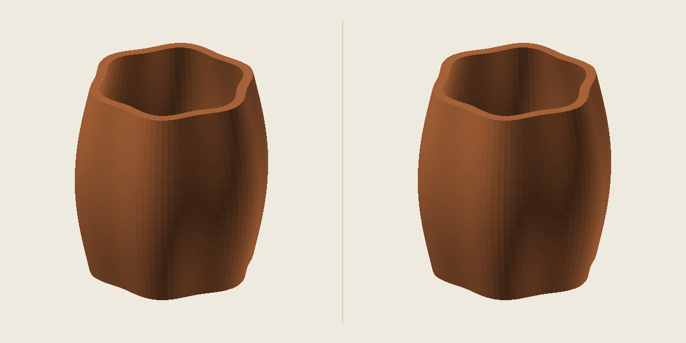

# Mesh to Print

Local mesh diagnostics and conservative repairs before you open your slicer.

**Python 3.10+ · standard library only · no account, API key, telemetry or model uploads**



The original six-flute vessel demo has a missing triangle, a reversed face, a duplicate and a degenerate. Explicit cleaning and a 5 mm planar-hole limit restore the missing triangle while retaining its hollow interior. The picture shows measured geometry, not a slicer preview.

## Start

```sh
python3 run.py serve
```

Open the printed `http://127.0.0.1:PORT` address if your browser does not open automatically. Upload STL, triangulated OBJ or an embedded static GLB. Set physical units, target size and build envelope, then analyze or explicitly select repair. Download the escaped HTML report, JSON, source, full geometry previews, millimeter STL, neutral 3MF and ZIP bundle.

The browser server runs only on loopback. In environments that forbid listening sockets, use the same engine through the CLI:

```sh
python3 run.py demo --out examples
python3 run.py analyze examples/closed-cube.stl --out cube-report --units mm
python3 run.py analyze examples/thin-plate.stl --out thin-report --wall 1.2
python3 run.py repair examples/repairable-vessel.stl --out vessel-report --fill-holes-mm 5
```

Existing output directories are refused. Original files are never overwritten. GLB defaults to meters; STL and OBJ default to millimeters. `--units mm|cm|m|in` explicitly overrides that interpretation. `--size 120` sets the longest dimension to 120 mm and records the scale provenance.

## What it measures

- Boundary/nonmanifold edges, adjacent winding conflicts, duplicate/degenerate faces and vertex-link bowties.
- Edge-connected and vertex-connected components, with all components retained.
- Bounds, chosen-orientation build-envelope fit, bed-contact faces and an overhang-angle heuristic.
- Conditional signed/material volume for eligible closed consistently wound geometry. A 20 mm cube measures 8,000 mm³ under the stated nonintersection assumptions.
- Deterministic inward-normal thickness samples on eligible geometry up to 150,000 triangles, accelerated by a BVH. Attempted rays, valid hits, observed minimum and sample limits are explicit.
- Actual exported geometry re-read from STL/3MF bytes: counts, dimensions, coordinate precision and collapsed corners.

There is **no printable score or print-success guarantee**. Self-intersection detection is `not_assessed`; whole-mesh minimum wall certification is `unknown`. Thickness sampling can miss thin features. Overhangs do not decide actual support requirements. Intersecting/nested shell bounding boxes make material volume unavailable.

## Explicit repair

Repair welds near-duplicate positions at the selected mm tolerance, removes duplicate/degenerate triangles and fixes local winding with the fewest face flips. It retains global shell orientation, including inward cavity shells, and never deletes disconnected components or thickens geometry.

Small-hole closure is **off by default**. `--fill-holes-mm N` accepts only unbranched, simple, strictly convex planar boundary loops with at most 256 vertices and diameter at most N mm. Flat sheets and uncertain loops are skipped. This can close intentional openings; inspect before/after reports and geometry. No voxel remeshing or general nonplanar hole reconstruction is implemented.

```sh
python3 run.py repair part.stl --out reviewed-part --units mm --size 80 \
  --bed 220,220,250 --wall 1.2 --overhang 45 --samples 256 \
  --weld-tolerance 0.00001 --fill-holes-mm 3
```

The 3MF is a neutral Core geometry package in millimeters. It does not contain Bambu/Prusa project settings, filament profiles, supports or G-code. Real slicer import and physical printing remain unverified.

## Limits and local files

Inputs are at most 64 MiB, 1,000,000 triangles and 3,000,000 source position records. GLB requires an embedded uncompressed buffer and static triangle primitives; animations, skins, sparse accessors, morph targets, external resources and unsupported extensions are rejected. OBJ material-file references and nontriangular faces are rejected. Textures/materials are not transferred into printing geometry.

The server processes one isolated job at a time, with a finite queue, at most 16 session jobs, a 2 GiB workspace quota with per-job reservation and a 300 second timeout. Linux workers also enforce a 4 GiB address-space cap; macOS/Windows retain count, request, disk-reservation and timeout bounds without an OS memory cap. Large meshes can use substantial RAM: the measured one-million-triangle case peaked at 2.30 GB.

```sh
python3 run.py serve --no-browser --workspace local-jobs
# After stopping the server:
python3 run.py cleanup --workspace local-jobs
```

Cleanup removes only generated jobs inside a marked workspace. Restarting creates a fresh session; retained jobs are available as local files rather than automatically restored to the browser history.

## Verify

```sh
python3 -m unittest discover -s tests -v
node --test
python3 run.py demo --out benchmark-inputs --large
python3 tools/benchmark.py benchmark-inputs/benchmark-101888.stl --out benchmark-100k --samples 64
python3 tools/benchmark.py benchmark-inputs/benchmark-500736.stl --out benchmark-500k --samples 64
```

Node is needed only for frontend tests, not to run the product. CI covers Python 3.10, 3.12 and 3.14 on Linux, macOS and Windows. See [measured validation](docs/VALIDATION.md), [architecture](docs/ARCHITECTURE.md), [limitations](docs/LIMITATIONS.md) and [format research](docs/RESEARCH.md).

## License

MIT. All bundled fixtures are generated from the original procedural code in `meshprint/fixtures.py`.
